# adityapawar

 

  

   

💼 Selected Work
01 · PROJECT NAME
<!-- Add a screenshot: upload assets/project1.png, then remove these comment marks  -->

One-line description of what this project does and who it is for.

Stack: React · Node.js · MongoDB

View Code · Live Demo

 
<b>▸ How it works</b>

Frontend: what the user sees and how it is built
Backend: API, authentication, business logic
Database: what is stored and how it is structured
Highlight: the one feature you are proudest of

02 · PROJECT NAME
<!--  -->

One-line description.

Stack: ...

View Code · Live Demo

 
<b>▸ How it works</b>

Frontend: ...
Backend: ...
Highlight: ...

03 · PROJECT NAME
<!--  -->

One-line description.

Stack: ...

View Code · Live Demo

 
<b>▸ How it works</b>

Frontend: ...
Backend: ...
Highlight: ...

 

🧰 Toolbox
 
 
<b>▸ What I use them for</b>

Frontend: HTML, CSS, JavaScript, TypeScript, React
Backend: Node.js, Express, REST APIs
Databases: MongoDB, PostgreSQL
Tools: Git, GitHub, Postman, VS Code

 

⚙️ How I Work
 
 
<b>▸ In more detail</b>

Plan: define scope and requirements before writing code
Design: sketch the UI and the data model first
Build: small, reviewable commits; clean, readable code
Test: check edge cases, validate inputs, secure the routes
Ship: deploy early, collect feedback, iterate

 
📊 GitHub Stats

   
 

🤝 Let's Talk

Hiring for a Full Stack role? Have an idea worth building?

 

