## 💼 Selected Work

### 01 · SmartCrowd
AI-powered event crowd management app.

**Stack:** `React` · `Node.js` · `Express` · `MongoDB`

[View Code](https://github.com/AdityaPawar090/REPO_NAME) · [Live Demo](https://YOUR-LIVE-LINK)

<b>▸ How it works</b>

- **Frontend:** the dashboard organisers use to monitor crowds
- **Backend:** REST APIs built with Node.js and Express
- **Database:** event and crowd data stored in MongoDB
- **AI:** the feature that analyses and predicts crowd flow

## 🧰 Toolbox

<b>▸ What I use them for</b>

- **Frontend:** HTML, CSS, JavaScript, React, Next.js, Bootstrap, EJS
- **Backend:** Node.js, Express, REST APIs
- **Database:** MongoDB
- **Cloud and deploy:** AWS, Google Cloud, Vercel
- **Other:** Java, Git, GitHub

## ⚙️ How I Work

<b>▸ In more detail</b>

- **Plan:** define scope and requirements before writing code
- **Design:** sketch the UI and the data model first
- **Build:** small, reviewable commits; clean, readable code
- **Test:** check edge cases, validate inputs, secure the routes
- **Ship:** deploy early, collect feedback, iterate

## 🎮 Beyond Code

<b>▸ Interests</b>

- Gaming, tech blogs and experimenting with AI tools
- Exploring new frameworks and coding challenges

## 📊 GitHub Stats

## 🤝 Let's Talk

**Hiring for a Full Stack role? Have an idea worth building?**

